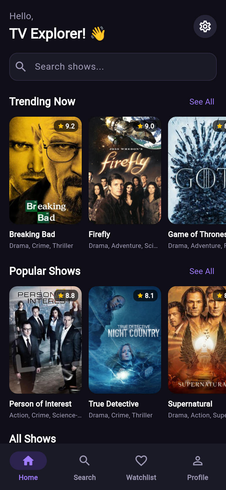
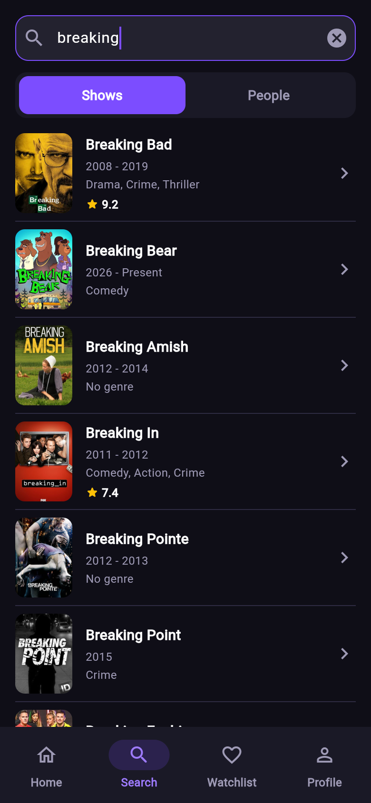
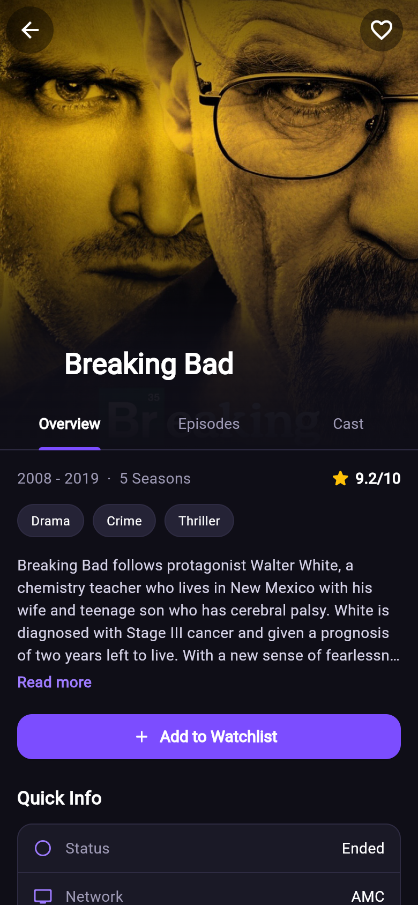
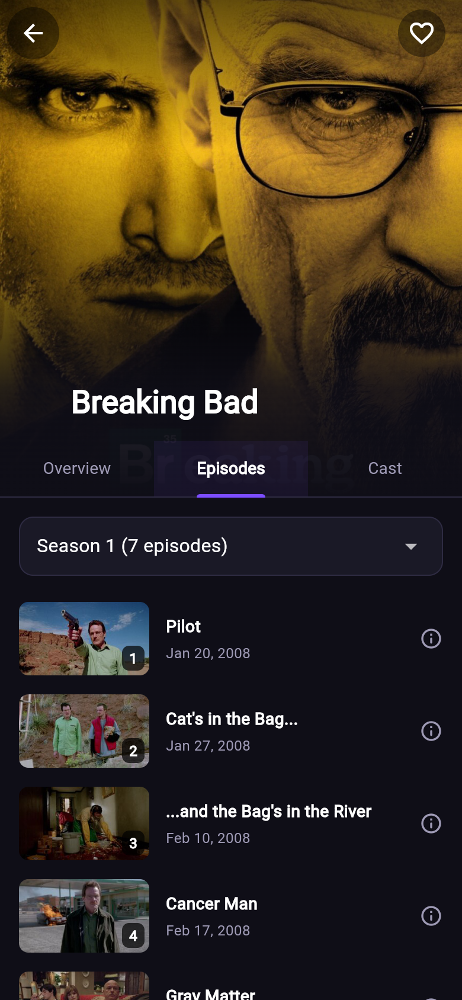
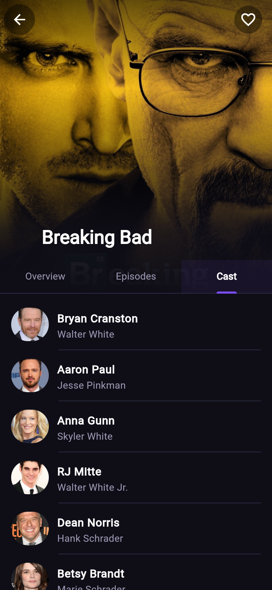
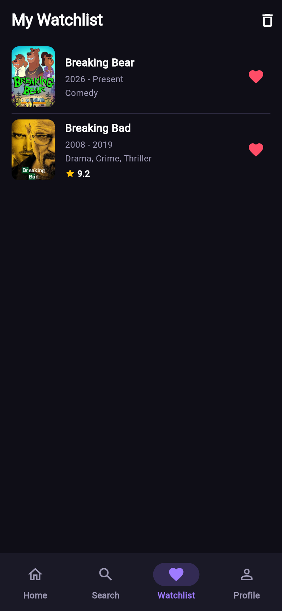
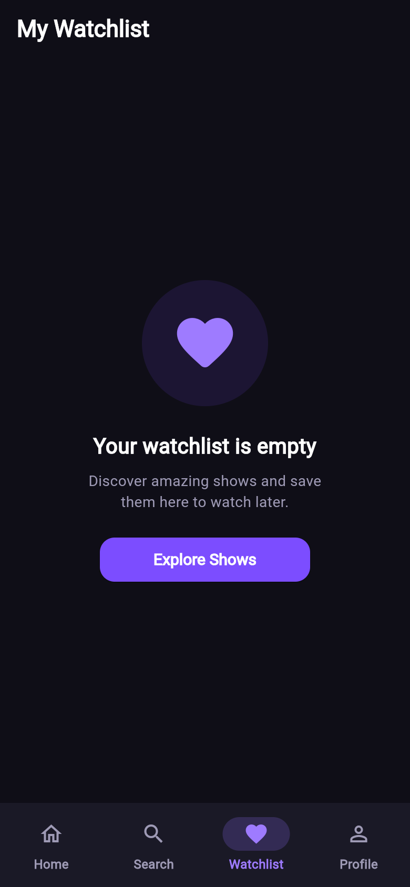
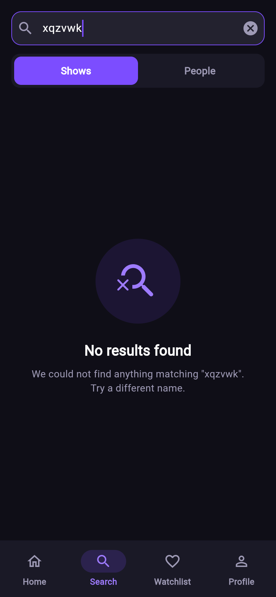
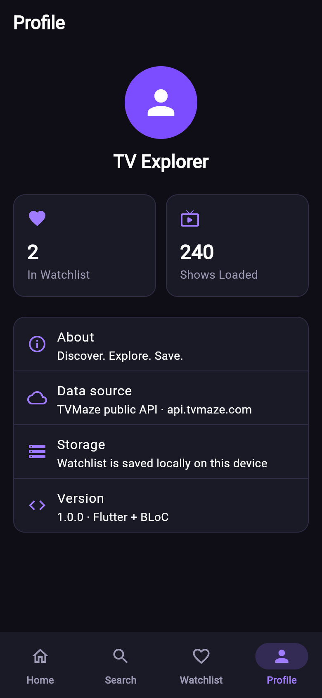

# TVMaze – TV Show Discovery App

**Discover. Explore. Save.**

A Flutter app for browsing TV shows, built with the **BLoC** state management pattern. All data comes from the free [TVMaze API](https://www.tvmaze.com/api). The app has no hardcoded show data.

## Features

| Area | What it does |
|---|---|
| **Discover** | Trending (top rated) and Popular carousels, plus an "All Shows" grid with **infinite scroll pagination** (`/shows?page=N`) and pull-to-refresh |
| **Search** | Searches shows *or* people by name. Search is **debounced by 500 ms**, so typing doesn't send an API call on every key press. Shows a message when there are no results |
| **Show details** | Poster, title, rating, genres, summary, and a Quick Info panel (status, network, language, runtime…) |
| **Episodes** | Grouped **by season** with a season picker. Tap an episode to see its summary |
| **Cast** | Actor photo, actor name, and the character they play |
| **Watchlist** | Add or remove shows from the details screen (heart icon or button). You can also swipe to delete, undo a removal, or clear everything. The list is **saved locally with SharedPreferences** and is still there after the app restarts |
| **States** | Every screen handles **loading, success, empty and error** states, and errors come with a *Try again* button |
| **Missing data** | Missing posters, ratings, summaries and networks fall back to placeholders. Malformed API items are skipped |

## Screenshots

| Discover | Search | Details | Episodes |
|---|---|---|---|
|  |  |  |  |

| Cast | Watchlist | Empty Watchlist | No Results | Profile |
|---|---|---|---|---|
|  |  |  |  |  |

## Setup

**Requirements:** Flutter SDK with Dart 3.13 or newer (built with Flutter 3.47.4), plus an Android emulator, a physical device, or Chrome.

```bash
git clone <your-repo-url>
cd tvmaze_app
flutter pub get
flutter run            # pick a device, or: flutter run -d chrome
```

Run the analyzer and tests:

```bash
flutter analyze
flutter test
```

No API key is needed, because TVMaze is a free public API.

## Packages

| Package | Why |
|---|---|
| `flutter_bloc` | BLoC state management (`Bloc`, `Cubit`, `BlocProvider`, `BlocBuilder`, `BlocListener`) |
| `equatable` | Value equality for events and states, so the UI only rebuilds when data really changes |
| `bloc_concurrency` | Event transformers: `droppable`, `restartable`, `sequential` |
| `stream_transform` | `debounce` + `switchMap` for the search debounce |
| `http` | REST calls to TVMaze |
| `shared_preferences` | Local storage for the watchlist |
| `bloc_test`, `mocktail` *(dev)* | Unit tests for the BLoCs |

## Project Structure

```
lib/
├── main.dart                 # Creates SharedPreferences, repositories, BlocObserver
├── app.dart                  # RepositoryProviders + BlocProviders + MaterialApp
├── core/
│   ├── constants/            # API base URL and endpoints
│   ├── errors/               # AppException + subclasses (Network, Timeout, NotFound…)
│   ├── theme/                # Colors and dark theme
│   └── utils/                # HTML stripping, date formatting, debounce transformer
├── data/
│   ├── models/               # Show, Episode, CastMember, Person (fromJson / toJson)
│   ├── services/             # TvMazeApiService: the ONLY class that does HTTP
│   └── repositories/         # ShowRepository (API), WatchlistRepository (local storage)
├── bloc/
│   ├── shows/                # Discover list + pagination
│   ├── search/               # Debounced search
│   ├── show_details/         # Details + cast + episodes for one show
│   ├── watchlist/            # Saved shows
│   ├── navigation/           # Bottom-tab Cubit
│   └── app_bloc_observer.dart
└── presentation/
    ├── screens/              # Home, Search, Details, Watchlist, Profile, See-All
    └── widgets/              # Reusable UI: poster card, list tile, state views…
test/                         # Model, API service and BLoC tests
```

## Architecture & BLoC Implementation

```
 UI (widgets)  ──event──▶  BLoC  ──calls──▶  Repository  ──▶  ApiService / SharedPreferences
      ▲                      │
      └──────new state───────┘
```

- **UI widgets never call the API.** They only `add()` events to a BLoC and rebuild from its state with `BlocBuilder`.
- **BLoCs** hold the business logic. They depend on **repositories**, not on `http`, so they can be unit tested with mocks.
- **`TvMazeApiService`** is the only class that knows about URLs, status codes and JSON. It turns every failure into a readable `AppException`, for example *"No internet connection…"*. The BLoC catches that exception and emits a `failure` state with the message.

### The BLoCs

| BLoC | Events | State | Notes |
|---|---|---|---|
| **ShowsBloc** (global) | `ShowsFetched`, `ShowsRefreshed` | `status`, `shows`, `nextPage`, `hasReachedMax`, `errorMessage` | Uses the **`droppable()`** transformer, so scroll events that arrive while a page is loading are ignored and the same page is never fetched twice. TVMaze returns **404 after the last page**, and the repository turns that into an empty list, which sets `hasReachedMax`. |
| **SearchBloc** (global) | `SearchQueryChanged`, `SearchTypeChanged`, `SearchRetried`, `SearchCleared` | `query`, `type` (shows/people), `status`, `shows`, `people`, `errorMessage` | `SearchQueryChanged` uses a custom **`debounce(500ms)` + `switchMap`** transformer. The API is called only after the user stops typing, and an older request is cancelled when a new one starts. A *stale check* throws away late results for an old query. |
| **ShowDetailsBloc** (one per details screen) | `ShowDetailsStarted`, `ShowInfoRequested`, `ShowCastRequested`, `ShowEpisodesRequested`, `SeasonSelected` | Separate status and error for **info**, **cast** and **episodes**, plus `episodesBySeason` and `selectedSeason` | `Started` adds the three load events, which run **in parallel**. If the cast request fails, the episodes still load, and each tab has its own Retry. The show tapped in the list is used as `initialShow`, so the header appears immediately. |
| **WatchlistBloc** (global) | `WatchlistLoaded`, `WatchlistToggled`, `WatchlistShowRemoved`, `WatchlistCleared` | `status`, `shows`, `errorMessage` | Uses **`sequential()`**, so rapid taps never interleave writes. The UI updates **optimistically** and is **rolled back** if saving fails. |
| **NavigationCubit** | `select(tab)` | `AppTab` | Lets any screen switch the bottom tab (search bar → Search, *Explore Shows* → Home). |

Each status enum covers **initial / loading / success / empty / failure**, and every screen has a matching view (`LoadingView`, `EmptyView`, `ErrorView`).

`AppBlocObserver` prints every event and state change to the debug console. This is handy for watching the BLoC flow live.

### Example flow: searching "dark"

1. The user types `d`, `da`, `dar`, `dark`. The `TextField` adds a `SearchQueryChanged` event on each key press.
2. The debounce transformer waits 500 ms after the last key press and passes on only `dark`.
3. The handler emits `status: loading`, then calls `repository.searchShows('dark')`, which calls `GET /search/shows?q=dark`.
4. It then emits `success` with the results, `empty` if the list is empty, or `failure` with the error message if the request failed.
5. `BlocBuilder<SearchBloc, SearchState>` rebuilds the result list, the "No results found" message, or the error view.

## API Endpoints Used

| Feature | Endpoint |
|---|---|
| Get TV shows / load more | `GET https://api.tvmaze.com/shows?page={n}` |
| Search shows | `GET https://api.tvmaze.com/search/shows?q={query}` |
| Search people | `GET https://api.tvmaze.com/search/people?q={query}` |
| Show details | `GET https://api.tvmaze.com/shows/{id}` |
| Show cast | `GET https://api.tvmaze.com/shows/{id}/cast` |
| Show episodes | `GET https://api.tvmaze.com/shows/{id}/episodes` |

## Error Handling

| Situation | What the user sees |
|---|---|
| No internet / connection failure | "No internet connection…" with a *Try again* button |
| Request takes longer than 15 s | Timeout message with retry |
| HTTP 429 (rate limited) | "Too many requests, please wait…" |
| Other HTTP errors | "Something went wrong on the server (code)" |
| Invalid JSON | "Received unexpected data from the server." |
| Pagination page fails | Shows that are already loaded stay on screen, and a Retry button appears at the bottom |
| Missing poster / rating / summary | Placeholder icon, "No rating", "No summary available" |
| Corrupted local watchlist | Falls back to an empty list instead of crashing |
